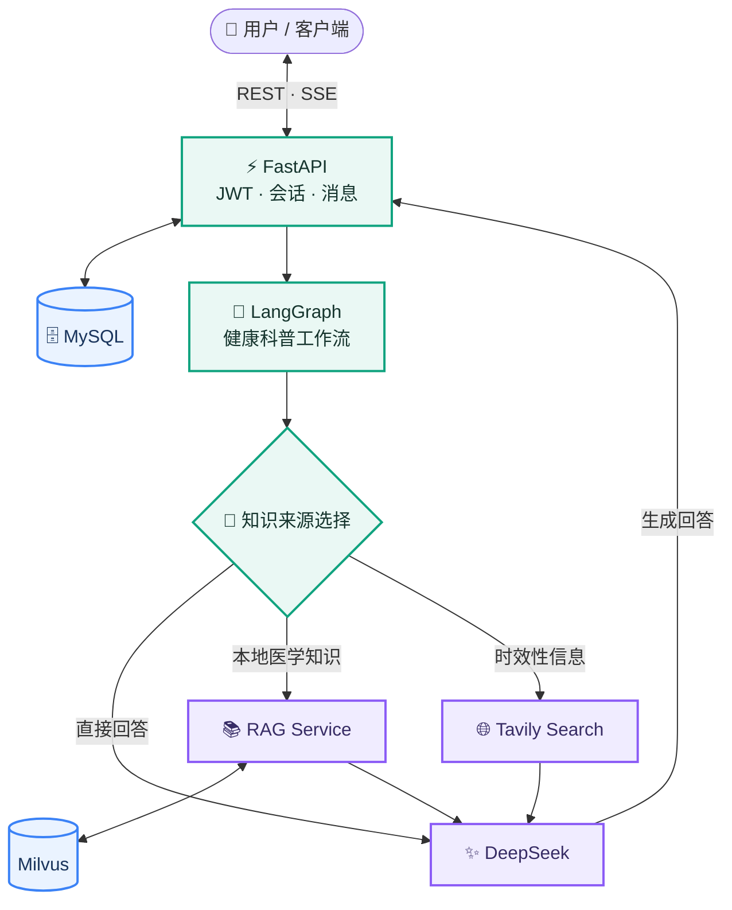

<div align="center">

<h1 align="center">🩺 MedCore</h1>

<h3 align="center">面向普通用户的中文医学科普问答系统</h3>

**让一次健康问答，从问题理解、知识检索到回答输出，都有清晰的工程链路。**

<p>
  
  
  
  
</p>
<p>
  
  
  
  
  
  
</p>

[✨ 核心能力](#features) · [🏗️ 系统架构](#architecture) · [🚀 快速开始](#quickstart) · [🧪 检索实验](#retrieval) · [🔌 API](#api) · [🗂️ 项目结构](#structure)

</div>

---

**MedCore** 是一个基于 **FastAPI + LangGraph** 的中文健康科普问答后端。围绕真实的多轮问答场景，将用户与会话管理、知识来源选择、模型生成、流式响应和引用展示整合在一起：需要医学知识时查询本地 RAG，需要时效信息时调用 Web Search，其余问题由模型直接回答。

项目包含两部分：**在线问答应用**负责用户交互与业务流程；**离线检索工程**负责医学文档入库、检索实验和效果评测。两部分职责独立，通过服务接口连接。

<a name="features"></a>
## ✨ 核心能力

<table>
  <tr>
    <td width="50%" valign="top">
      <h3>🔐 用户与多轮会话</h3>
      JWT 登录鉴权 · MySQL 持久化 · 会话隔离<br/>
      <sub>创建会话、查看历史消息、继续对话及删除会话。</sub>
    </td>
    <td width="50%" valign="top">
      <h3>🧠 LangGraph 问答工作流</h3>
      上下文参与决策 · 工具按需调用<br/>
      <sub>在直接回答、本地医学检索和 Tavily 联网搜索之间选择信息路径。</sub>
    </td>
  </tr>
  <tr>
    <td width="50%" valign="top">
      <h3>⚡ SSE 流式交互</h3>
      工作流状态通知 · 回答增量输出<br/>
      <sub>通过 status、delta、done 等事件持续向客户端返回执行过程。</sub>
    </td>
    <td width="50%" valign="top">
      <h3>📚 检索与引用来源</h3>
      本地医学 RAG · 证据与来源关联<br/>
      <sub>保留检索证据，仅展示回答实际引用到的来源编号。</sub>
    </td>
  </tr>
</table>

### 💎 工程实现

- **业务与 AI 流程分离**：FastAPI 负责鉴权、会话和 HTTP 接口；LangGraph 组织知识选择与回答生成；本地 RAG 通过独立服务接口接入，避免把向量检索逻辑直接堆进聊天接口。
- **流式回答与数据一致性**：SSE 同时传递执行状态和文本增量，完整生成后再保存本轮消息，避免异常中断时把未完成内容写成正常回复。
- **可复现的检索实验**：独立 `rag/` 工程维护数据预处理、Milvus 入库、Dense / BM25 检索、Reranker 和离线评测，不与在线问答的运行过程混在一起。

<a name="architecture"></a>
## 🏗️ 系统架构



**一次问答的处理过程：** 客户端携带 JWT 提交消息 → 后端读取会话历史 → LangGraph 选择信息路径 → DeepSeek 结合上下文与检索内容生成回答 → SSE 发送状态与文本增量 → 完整回复持久化。

**组件分工**

| 组件 | 职责 |
| :--- | :--- |
| **FastAPI / MySQL** | 登录、会话、历史记录、HTTP 接口和数据持久化 |
| **LangGraph / DeepSeek** | 问答流程控制、工具调用与回答生成 |
| **RAG Service / Milvus** | 在线知识检索，向工作流返回检索内容及来源 |
| **Tavily** | 需要外部时效信息时提供联网搜索结果 |
| **`rag/`** | 独立的文档入库、检索与评测实验工程，不充当在线 HTTP 服务 |

<a name="quickstart"></a>
## 🚀 快速开始

**环境要求**：Python 3.11+、[uv](https://docs.astral.sh/uv/)、MySQL。调用 LLM、在线 RAG 和联网搜索时，需要配置对应服务或 API Key。

**1. 安装依赖并配置环境**

```bash
uv sync --frozen
cp .env.example .env
```

编辑 `.env`，填写 MySQL 连接参数、`JWT_SECRET_KEY` 和 `DEEPSEEK_API_KEY`；按需配置 `RAG_SERVICE_URL`、`TAVILY_API_KEY`。可使用以下命令生成 JWT 密钥：

```bash
python -c "import secrets; print(secrets.token_urlsafe(32))"
```

**2. 初始化数据库**

```bash
PYTHONPATH=src .venv/bin/alembic upgrade head
```

**3. 启动后端**

```bash
PYTHONPATH=src .venv/bin/uvicorn medcore.main:app \
  --host 127.0.0.1 --port 8089 --reload
```

启动后访问 **[Swagger UI](http://127.0.0.1:8089/docs)** 或 **[OpenAPI JSON](http://127.0.0.1:8089/openapi.json)**。

<details>
<summary><b>⚙️ 展开环境变量配置</b></summary>

| 环境变量 | 用途 |
| :--- | :--- |
| `MYSQL_HOST` / `MYSQL_PORT` | MySQL 地址与端口 |
| `MYSQL_USER` / `MYSQL_PASSWORD` / `MYSQL_DATABASE` | MySQL 连接信息 |
| `JWT_SECRET_KEY` | JWT 签发与验证 |
| `DEEPSEEK_API_KEY` / `DEEPSEEK_MODEL` | LLM 调用 |
| `RAG_SERVICE_URL` | 在线检索服务地址，默认 `http://127.0.0.1:8091` |
| `RAG_SERVICE_TOKEN` | 在线 RAG 服务使用鉴权时的令牌 |
| `RAG_TOP_K` | 本地检索返回数量，默认 5，范围 1–10 |
| `TAVILY_API_KEY` | 联网搜索 API Key |

请勿将包含凭据的 `.env` 文件提交到仓库。本地 RAG 服务需单独运行；离线 `rag/` 目录中的实验脚本不会提供 `POST /retrieve` HTTP 接口。

</details>

<a name="retrieval"></a>
## 🧪 医学 RAG · 离线检索实验

项目使用 [**CMedTEB**](https://huggingface.co/datasets/PhilipGAQ/CMedTEB) 的 **229,457 篇中文医疗文档、734 条检索 Query** 及对应 qrels 进行离线评测。文档经自然边界切分后使用 BGE-M3 编码，写入 Milvus；评测时将 Chunk 命中聚合回原始文档 ID，与 qrels 对齐。

| 检索方案 | Hit@5 ↑ | MRR@10 ↑ | nDCG@10 ↑ | Recall@100 ↑ |
| :--- | ---: | ---: | ---: | ---: |
| BM25 · Character 2–3 gram | 52.18% | 0.3964 | 0.2499 | 52.86% |
| BGE-M3 Dense | 80.79% | 0.6847 | 0.4694 | 70.92% |
| **Dense + BGE Reranker v2 M3** | **84.88%** | **0.7286** | **0.5064** | **70.92%** |

> **实验观察**：加入 Reranker 后，**Hit@5 提高 4.09 个百分点**，**MRR@10 提高 0.0438**。精排改善了靠前排序，但不改变 Top 100 候选集合的覆盖范围。以上是离线检索相关性指标，不是医学答案准确率。

<details>
<summary><b>🔬 展开检索实验配置与运行命令</b></summary>

**Dense**：BGE-M3（1024 维）、Milvus IP；文档切分约 1,000 字符、重叠 100 字符。  
**BM25**：字符 2–3 gram，本地独立索引。  
**Reranker**：BGE Reranker v2 M3；`chunk_top_k=200`、`candidate_top_k=100`、`rerank_top_k=15`、`max_length=512`。

```bash
cd rag
uv sync --frozen --no-install-project

# 文档校验、向量化和入库
.venv/bin/python src/code/cmed/ingest.py --dry-run
.venv/bin/python src/code/cmed/ingest.py

# Dense 评测
.venv/bin/python src/code/cmed/Dense_Retrieval/evaluate.py \
  --details outputs/cmed_retrieval_details.jsonl

# BM25 索引和评测
.venv/bin/python src/code/cmed/BM25/bm25_index.py
.venv/bin/python src/code/cmed/BM25/evaluate.py

# Reranker 评测
.venv/bin/python src/code/cmed/rerank/evaluate.py \
  --details outputs/cmed_rerank_details.jsonl
```

模型权重与 Milvus 数据需在本地准备，默认 Collection 为 `cmedteb_retrieval_1000`。

</details>

<a name="api"></a>
## 🔌 API 概览

| Method | Endpoint | 功能 |
| :---: | :--- | :--- |
| `POST` | `/auth/register` | 注册 |
| `POST` | `/auth/login` | 登录，获取 JWT |
| `POST` | `/api/v1/chats` | 创建会话 |
| `GET` | `/api/v1/chats` | 获取会话列表 |
| `GET` | `/api/v1/chats/{id}/messages` | 分页获取历史消息 |
| `POST` | `/api/v1/chats/{id}/turns` | 非流式问答 |
| `POST` | `/api/v1/chats/{id}/turns/stream` | SSE 流式问答 |
| `DELETE` | `/api/v1/chats/{id}` | 删除会话与消息 |

会话接口使用 `Authorization: Bearer <access_token>`。流式接口使用如下请求体：

```json
{"content": "糖尿病有哪些常见症状？"}
```

SSE 输出 `status`、`delta` 和 `done` 等事件；遇到异常时返回 `error` 事件。

<a name="structure"></a>
## 🗂️ 项目结构

```text
medcore/
├── src/medcore/
│   ├── api/                     # API 路由与鉴权
│   ├── services/                # 会话业务逻辑
│   ├── repositories/            # 数据访问
│   ├── database/                # SQLAlchemy / MySQL
│   ├── workflows/education/     # LangGraph 健康科普工作流
│   ├── llm/                     # DeepSeek 客户端
│   ├── rag/                     # 在线检索服务 HTTP 客户端
│   └── capabilities/web_search/ # Tavily 联网搜索
├── migrations/                  # Alembic 数据库迁移
├── tests/                       # 后端自动化测试
└── rag/                         # CMedTEB 离线入库、检索与评测
```

<details>
<summary><b>🧪 展开测试命令</b></summary>

```bash
# 后端测试（项目根目录）
PYTHONPATH=src .venv/bin/python -m unittest discover -s tests -q

# 检索实验测试（rag/ 目录）
.venv/bin/python -m unittest src/code/cmed/test_ingest.py
.venv/bin/python src/code/cmed/Dense_Retrieval/test_retrieval.py
```

</details>

---

> [!IMPORTANT]
> **使用说明**：MedCore 提供健康知识科普，不替代医生诊断、处方或急救建议。检索相关不代表医学事实已经核验。CMedTEB 数据集采用 **CC BY-NC-SA 4.0** 许可，使用时须遵守其非商业及署名要求。

<div align="center">
  <sub>🩺 <b>MedCore</b> · 中文医学科普问答 · FastAPI × LangGraph × RAG</sub>
</div>
