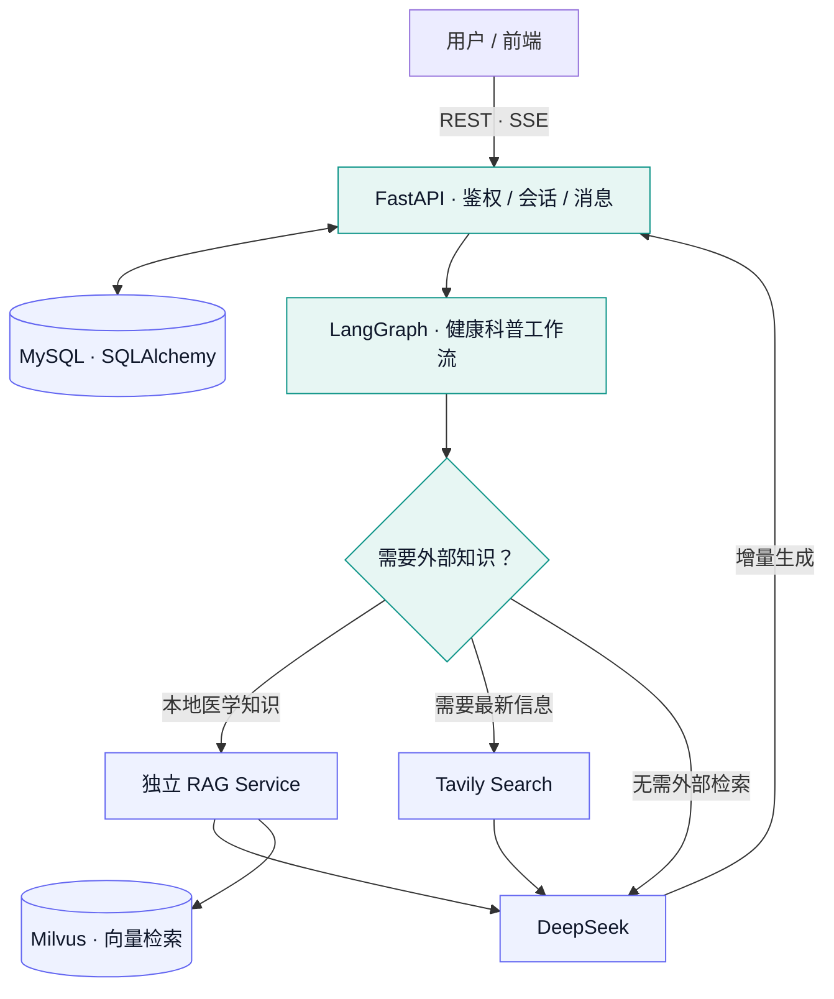
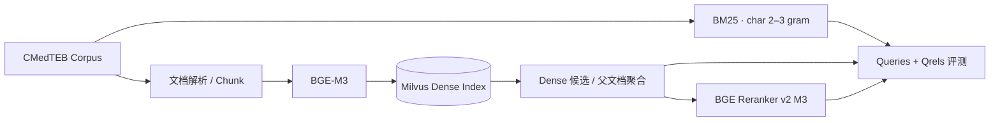

<h1 align="center">🩺 MedCore</h1>
<h3 align="center">让健康科普回答有据可查</h3>

<p align="center">
  <strong>面向普通用户的中文医学知识问答后端</strong><br/>
  检索增强生成（RAG） · LangGraph 工作流 · 流式回答 · 可复现的检索评测
</p>

<p align="center">
  
  
  
  
  
  
</p>

<p align="center">
  <a href="#项目亮点">项目亮点</a> · <a href="#架构设计">架构设计</a> · <a href="#检索实验">检索实验</a> · <a href="#快速开始">快速开始</a> · <a href="#接口概览">接口</a> · <a href="#当前状态与开发计划">开发计划</a>
</p>

---

> **为什么做 MedCore？**  通用大模型可以流畅地回答医学问题，但回答可能缺少依据，涉及药品、疾病和检查指标时尤其需要区分模型生成内容与可检索的知识。MedCore 将**医学证据检索、对话工作流、回答生成和结果追踪**拆成可测试的环节，重点研究如何让中文医学知识问答更可靠、更可评估。

> [!IMPORTANT]
> **使用边界**：MedCore 当前提供医学知识科普，不提供疾病诊断、个体化处方或急救决策。现阶段的引用编号不等于已完成逐句事实核验；检索相关性高也不代表医学内容一定准确。

## 项目亮点

<table>
  <tr>
    <td align="center"><strong>229,457</strong><br/><sub>CMedTEB 检索语料</sub></td>
    <td align="center"><strong>734</strong><br/><sub>标准测试问题</sub></td>
    <td align="center"><strong>84.88%</strong><br/><sub>Rerank 后 Hit@5</sub></td>
    <td align="center"><strong>+4.09 pp</strong><br/><sub>相对 Dense 的 Hit@5 提升</sub></td>
  </tr>
</table>

**01 · 把 RAG 做成可量化的检索工程，而不只是一次向量查询**  
使用 CMedTEB 的 Corpus / Queries / Qrels 建立离线检索评测流程。围绕 **BGE-M3 Dense、字符 n-gram BM25、BGE Reranker v2 M3** 对比 Hit Rate、Recall、MRR、nDCG，并保存可追查的测试明细。

**02 · 检索与业务解耦**  
医学检索由独立 RAG 组件承载；FastAPI 负责鉴权、会话和对外 API，LangGraph 负责按需选择本地知识、联网搜索或直接回答。离线实验目录与在线检索服务职责明确分离。

**03 · 流式交互与会话持久化**  
支持 JWT 鉴权、多会话隔离和消息历史查询；通过 SSE 返回工作流状态与回答增量，完整生成后持久化消息，避免把未完成回复当作正常回答保存。

**04 · 对生成内容保留边界意识**  
检索结果附带来源信息；展示实际引用的来源编号，但不把“引用存在”当作“事实得到证明”。医学安全评测、逐句证据核验和失败补检属于后续重点。

## 架构设计



**一个问题如何被处理？** 用户请求先进入鉴权与会话层，工作流结合上下文判断是否需要外部知识；检索得到的证据与对话历史一起交给模型生成，服务端再通过 SSE 持续返回内容。当前属于**受控工具选择工作流**，不是支持无限轮自主检索的 Agent。

## 检索实验

这是 MedCore 当前最重点的工程模块。与直接拿模型给参考答案打分不同，CMedTEB 提供**文档 ID 级相关性标注（qrels）**，可直接复现检索指标。

### 数据与流水线

| 内容 | 配置 |
| --- | --- |
| 数据集 | [CMedTEB](https://huggingface.co/datasets/PhilipGAQ/CMedTEB) |
| Corpus | 229,457 篇中文医疗文档 |
| 测试集 | 734 条 Query |
| 相关性标注 | 329,578 条 qrels 记录，具体相关等级以标签为准 |
| Dense | BGE-M3 · 1024 维 · Milvus IP |
| 文档组织 | 自然边界切分，约 1,000 字符 / 100 字符重叠，结果回聚合至原始文档 ID |
| Sparse 基线 | BM25 · character 2–3 gram（独立本地索引） |
| 精排 | BGE Reranker v2 M3 · 最大输入长度 512 |



> 为保证官方 qrels 仍然有效，Chunk 召回结果在评测前需映射回原始 `doc_id`；不能直接把 Chunk ID 与 qrels 对比。

### 实验成绩

在**同一批 734 条测试问题**上比较，相关性由 CMedTEB qrels 判定。

| 检索方案 | Hit@1 ↑ | Hit@5 ↑ | Recall@5 ↑ | MRR@10 ↑ | nDCG@10 ↑ |
| :--- | ---: | ---: | ---: | ---: | ---: |
| BM25 · char 2–3 gram | 30.25% | 52.18% | 15.61% | 0.3964 | 0.2499 |
| BGE-M3 Dense | 59.54% | 80.79% | 30.69% | 0.6847 | 0.4694 |
| **Dense + BGE Reranker v2 M3** | **63.90%** | **84.88%** | **34.03%** | **0.7286** | **0.5064** |

**精排的实际收益（相对于 Dense 基线）：**

- **Hit@5：80.79% → 84.88%（+4.09 个百分点）**，更多问题能在前五名拿到至少一篇相关文档。
- **MRR@10：0.6847 → 0.7286（+0.0438）**，第一篇相关文档的位置更靠前。
- **nDCG@5：0.4988 → 0.5496（+0.0508）**，前五名的整体相关性排序得到改善。
- **Recall@100：70.92% → 70.92%（不变）**，验证了重排序无法凭空补出未进入候选集的文档。

**实验设置**：先对 Dense 检索得到的前 100 个父文档候选中的前 15 个做精排；`chunk_top_k=200`、`candidate_top_k=100`、`rerank_top_k=15`。完整的 734 条 Query 实验总耗时约 309 秒，其中精排约 226 秒，批处理吞吐约 2.37 QPS。上述吞吐不等价于线上单请求延迟。

> [!NOTE]
> **如何解读指标？** Hit@5 表示前五名是否至少有一篇被标注为相关的文档；Recall@5 表示前五名找回了多少**已标注**相关文档。MRR 关注第一个相关结果的位置，nDCG 关注整体排序。它们评估的是**检索相关性**，不是模型生成答案的医学正确率。

**当前发现**：Dense 在这组语料上显著优于字符 n-gram BM25；Reranker 能改善靠前排名，但无法提升候选集合的召回上限。下一步将优先测试 **Dense 与 BM25 的候选互补性、BGE-M3 Sparse、RRF 融合**，再评估扩大精排候选数量的收益与延迟成本。

<details>
<summary><strong>查看检索实验运行命令</strong></summary>

先准备 `rag/` 独立环境与本地模型文件；Milvus 默认地址为 `http://localhost:19530`，Collection 为 `cmedteb_retrieval_1000`。

```bash
cd rag
uv sync --frozen --no-install-project

# 入库前检查（不加载模型、不连接 Milvus）
.venv/bin/python src/code/cmed/ingest.py --dry-run

# 向量化和 Milvus 入库
.venv/bin/python src/code/cmed/ingest.py

# Dense 检索与评测
.venv/bin/python src/code/cmed/Dense_Retrieval/search.py \
  --query "糖尿病患者应该如何控制饮食？" --top-k 5
.venv/bin/python src/code/cmed/Dense_Retrieval/evaluate.py \
  --details outputs/cmed_retrieval_details.jsonl

# BM25 建索引与评测
.venv/bin/python src/code/cmed/BM25/bm25_index.py
.venv/bin/python src/code/cmed/BM25/evaluate.py

# Reranker 评测
.venv/bin/python src/code/cmed/rerank/evaluate.py \
  --details outputs/cmed_rerank_details.jsonl
```

模型文件和 Milvus 数据不随仓库分发。实验前检查代码中的数据路径、模型目录及 Collection 配置。

</details>

## 快速开始

### 1. 启动后端环境

要求 **Python 3.11+、[uv](https://docs.astral.sh/uv/)、MySQL**，并为需要的 RAG / LLM / 联网能力准备对应服务与密钥。

```bash
uv sync --frozen
cp .env.example .env
```

在 `.env` 中至少配置 MySQL 连接、`JWT_SECRET_KEY`、`DEEPSEEK_API_KEY`。可通过以下命令生成 JWT 密钥：

```bash
python -c "import secrets; print(secrets.token_urlsafe(32))"
```

### 2. 迁移数据库并启动 API

```bash
PYTHONPATH=src .venv/bin/alembic upgrade head

PYTHONPATH=src .venv/bin/uvicorn medcore.main:app \
  --host 127.0.0.1 --port 8089 --reload
```

启动后查看 [Swagger UI](http://127.0.0.1:8089/docs) 或 [OpenAPI JSON](http://127.0.0.1:8089/openapi.json)。默认监听本机；联调时需要单独启动在线 RAG 服务，**`rag/` 离线评测脚本并不提供 HTTP `/retrieve` 接口**。

<details>
<summary><strong>展开环境变量</strong></summary>

| 配置项 | 说明 |
| --- | --- |
| `MYSQL_HOST` / `MYSQL_PORT` / `MYSQL_USER` / `MYSQL_PASSWORD` / `MYSQL_DATABASE` | 数据库连接 |
| `JWT_SECRET_KEY` | JWT 签发与验证 |
| `DEEPSEEK_API_KEY` / `DEEPSEEK_MODEL` | 生成模型 |
| `RAG_SERVICE_URL` | 在线 RAG 地址，默认 `http://127.0.0.1:8091` |
| `RAG_SERVICE_TOKEN` | RAG 服务鉴权令牌（启用时） |
| `RAG_TOP_K` | 本地知识检索数量，默认 5，可配置 1–10 |
| `TAVILY_API_KEY` | 联网检索凭据 |

请勿提交包含密钥的 `.env` 文件。`/check_health` 当前是占位接口，不代表所有外部依赖可用。

</details>

## 接口概览

| 方法 | 路径 | 说明 |
| :---: | --- | --- |
| `POST` | `/auth/register` | 注册用户 |
| `POST` | `/auth/login` | 登录并获得 JWT |
| `POST` | `/api/v1/chats` | 创建会话 |
| `GET` | `/api/v1/chats` | 查看会话列表 |
| `GET` | `/api/v1/chats/{id}/messages` | 分页读取历史 |
| `POST` | `/api/v1/chats/{id}/turns` | 普通问答 |
| `POST` | `/api/v1/chats/{id}/turns/stream` | SSE 流式问答 |
| `DELETE` | `/api/v1/chats/{id}` | 删除会话 |

流式接口请求示例（需 `Authorization: Bearer <access_token>`）：

```json
{ "content": "糖尿病有哪些常见症状？" }
```

SSE 返回 `status`、`delta`、`done` 等事件；异常时返回 `error`，不将未完成的回答写入消息历史。

## 工程结构

```text
medcore/
├── src/medcore/
│   ├── api/                    # API / 鉴权依赖
│   ├── services/               # 业务服务与会话管理
│   ├── repositories/           # 数据访问
│   ├── database/               # SQLAlchemy / MySQL
│   ├── workflows/education/    # LangGraph 工作流
│   ├── llm/                    # DeepSeek 客户端
│   ├── rag/                    # 在线 RAG HTTP 客户端
│   └── capabilities/web_search/# 联网检索
├── migrations/                 # Alembic 数据库迁移
├── tests/                      # 后端自动化测试
└── rag/                        # CMedTEB 离线入库 / 检索 / 评测
```

`rag_service/` 为在线检索服务组件，需与上述离线实验目录区分；是否置于同一仓库，以实际部署方式为准。

## 当前状态与开发计划

| 模块 | 状态 | 备注 |
| --- | :---: | --- |
| JWT 鉴权 / 多会话 / 历史持久化 | ✅ | 已实现 |
| LangGraph 按需选择 RAG / Web Search | ✅ | 当前单轮工具选择，最多 2 次工具调用 |
| SSE 增量回复与状态事件 | ✅ | 已实现 |
| 引用来源编号展示 | 🟡 | 尚未完成逐句证据一致性审计 |
| CMedTEB Dense / BM25 / Reranker 离线评测 | ✅ | 已有 734 条 Query 实验 |
| BM25 / Dense 互补召回与 RRF | ⏳ | 待实验验证 |
| BGE-M3 Sparse 检索 | ⏳ | 待实现 |
| 医学安全评测与回答事实核验 | ⏳ | 后续重点 |
| 多轮主动补检 / 上下文压缩 | ⏳ | 待实现 |
| 症状诊断 / 临床分诊 | ⛔ | 不属于当前医学科普 MVP |

### 测试

```bash
# 后端测试
PYTHONPATH=src .venv/bin/python -m unittest discover -s tests -q

# 离线数据与检索测试（在 rag/ 目录下）
.venv/bin/python -m unittest src/code/cmed/test_ingest.py
.venv/bin/python src/code/cmed/Dense_Retrieval/test_retrieval.py
```

> **数据与使用范围**：CMedTEB 采用 **CC BY-NC-SA 4.0** 许可证。请遵守数据集的非商业及署名要求；数据授权不等同于 MedCore 源代码的授权。医学知识库内容仍需开展来源、时效性和事实质量审核。

---

<div align="center">
  <sub><strong>MedCore</strong> · 不只让模型回答，更让检索过程可追踪、可比较、可优化。</sub>
</div>
