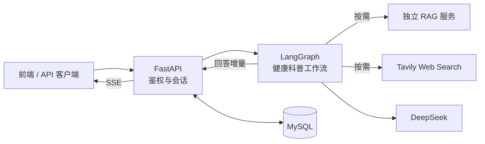

<div align="center">
  <h1>✦ MedCore</h1>
  <p><strong>有依据、可追溯的健康科普后端</strong></p>
  <p>多会话管理 · 按需医学检索 · 流式 AI 回答</p>
  <p>
    
    
    
    
  </p>
  <p><a href="#快速开始">快速开始</a> · <a href="#系统架构">系统架构</a> · <a href="#能力与边界">能力与边界</a> · <a href="#rag-离线实验">RAG 实验</a> · <a href="#接口概览">接口概览</a></p>
</div>

---

MedCore 当前聚焦**面向普通用户的健康科普**。它结合会话历史理解问题，按需查询本地医学知识库或联网搜索，再用 DeepSeek 生成中文回答。项目仍处于 MVP 阶段，目标是建立可测试、可迭代的问答链路，而不是宣称具备临床诊断能力。

> [!IMPORTANT]
> 本目录包含 FastAPI 后端和 `rag/` 下的离线检索实验。Vue 前端、在线 `rag_service`、Milvus 和外部模型服务仍需独立部署；`rag/` 本身不是 HTTP 服务。MedCore 不能替代医生诊断、处方或急救服务。

## 一眼看懂

| 项目 | 当前实现 |
| :--- | :--- |
| 核心场景 | 健康科普与多轮问答 |
| 技术栈 | Python 3.11+ · FastAPI · LangGraph · SQLAlchemy · MySQL |
| 模型与工具 | DeepSeek（OpenAI 兼容接口）· 本地 RAG · Tavily Web Search |
| 交互方式 | REST API + SSE 流式回答 |
| 目录范围 | 后端 API、业务服务、工作流、数据库迁移、测试与离线 RAG 实验 |

## 快速开始

先准备 Python 3.11+、[uv](https://docs.astral.sh/uv/)、MySQL 和 DeepSeek API Key。在仓库根目录执行：

```bash
uv sync --frozen
cp .env.example .env
```

编辑 `.env`，至少设置 MySQL 连接信息、`JWT_SECRET_KEY` 和 `DEEPSEEK_API_KEY`。生成 JWT 密钥可以使用：

```bash
python -c "import secrets; print(secrets.token_urlsafe(32))"
```

随后执行数据库迁移并启动 API：

```bash
PYTHONPATH=src .venv/bin/alembic upgrade head
PYTHONPATH=src .venv/bin/uvicorn medcore.main:app --host 127.0.0.1 --port 8089 --reload
```

打开 [交互式 API 文档](http://127.0.0.1:8089/docs) 验证服务已启动。这里**不要**把 `/check_health` 当作完整健康检查：该接口目前只是占位实现。后端默认仅监听本机；若需外部访问，请通过前端代理或反向代理发布。

### 环境配置

| 配置项 | 用途 | 何时需要 |
| :--- | :--- | :--- |
| `MYSQL_HOST` / `MYSQL_PORT` / `MYSQL_USER` / `MYSQL_PASSWORD` / `MYSQL_DATABASE` | 连接业务数据库 | 启动后端前 |
| `JWT_SECRET_KEY` | 签发和验证登录令牌 | 注册、登录与鉴权 |
| `DEEPSEEK_API_KEY` / `DEEPSEEK_MODEL` | 生成回答与工具选择 | AI 问答 |
| `RAG_SERVICE_URL` / `RAG_TOP_K` | 访问独立 RAG 服务；默认地址为 `http://127.0.0.1:8091` | 使用本地检索时 |
| `TAVILY_API_KEY` | 联网搜索 | 使用 Web Search 时 |

本地 RAG 服务必须单独部署和启动；`RAG_SERVICE_TOKEN` 可按需配置。**不要把真实的 `.env` 或 API Key 提交到 Git。**

## 系统架构



前端发送问题后，后端验证 JWT、读取最近的会话历史，再运行工作流。工作流先决定是否调用检索工具，随后生成回答；流式接口通过 `status` 和 `delta` 事件返回进度与文本，**完整生成后**才保存本轮消息。详细设计见[健康科普架构文档](docs/health-education-architecture.md)。

## 能力与边界

| 能力 | 状态 | 说明 |
| :--- | :---: | :--- |
| 用户鉴权与多会话持久化 | 已实现 | JWT、会话隔离、历史消息分页 |
| 本地 RAG / 联网搜索工具 | 已接入 | 模型按需选择；外部服务需单独配置 |
| SSE 流式回答 | 已实现 | 规划、检索、生成状态与回答增量 |
| 引用来源展示 | 初步实现 | 只返回答案中出现编号的来源；尚未验证逐句支持关系 |
| 基于检索结果继续补检 | 未实现 | 当前只有一轮工具选择，不是自主循环 Agent |
| 症状问诊与临床分诊 | 未实现 | 不应将健康科普功能用于确定性诊断 |

### 当前默认参数

这些是代码中的默认值或限制，**不是性能指标**：

| 参数 | 当前值 | 说明 |
| :--- | :---: | :--- |
| 参与本轮问答的历史消息 | 最近 12 条 | 尚未接入上下文压缩 |
| 单轮检索工具调用 | 最多 2 次 | 超出限制会报错 |
| 本地 RAG 召回数量 | 默认 5 条 | 可通过 `RAG_TOP_K` 调整，范围 1–10 |
| Web Search 返回数量 | 最多 5 条 | 由工具封装设置 |
| JWT 有效期 | 30 分钟 | 过期后需重新登录 |

## RAG 离线实验

`rag/` 是基于 [CMedTEB](rag/src/data/CMedTEB/README.md) 的中文医学检索实验工程，用于构建、比较和评测检索方案；它不监听端口，也不直接响应后端发出的 `POST /retrieve`。线上问答仍通过 `RAG_SERVICE_URL` 调用独立的 `rag_service`。

### 数据与检索链路

CMedTEB 数据随实验目录保存，当前包含 229,457 篇检索语料、734 条测试查询和 329,578 条 qrels；另有 1,128 条 rerank 测试数据，以及各 10,000 / 5,000 条 STS 训练 / 测试数据。数据许可证为 CC BY-NC-SA 4.0，详细结构见 [`data_stats.json`](rag/src/data/CMedTEB/data_stats.json)。

| 组件 | 实现 | 入口 |
| :--- | :--- | :--- |
| 语料入库 | 长文按自然边界切块，标题重复到各块；BGE-M3 生成 1024 维归一化向量并写入 Milvus | `rag/src/code/cmed/ingest.py` |
| Dense Retrieval | BGE-M3 查询编码 + Milvus IP 检索；按 `parent_doc_id` 聚合 chunk | `rag/src/code/cmed/Dense_Retrieval/` |
| BM25 | 中文字符 2–3 gram、`k1=1.5`、`b=0.75` 的本地稀疏索引 | `rag/src/code/cmed/BM25/` |
| Reranker | Dense 候选经过 `bge-reranker-v2-m3` CrossEncoder 重排 | `rag/src/code/cmed/rerank/` |
| 标准评测 | 使用 query/qrels 计算 Recall、Precision、Hit Rate、MRR、nDCG 和 MAP | 各检索目录下的 `evaluate.py` |

默认路径约定如下：

- Dense 模型：`rag/models/bge-m3`
- Reranker 模型：`rag/models/bge-reranker-v2-m3`
- Milvus：`http://localhost:19530`
- Collection：`cmedteb_retrieval_1000`
- Dense 入库参数：超过 1,000 字符才切分，chunk 上限 1,000 字符，重叠 100 字符

模型文件和 Milvus 数据不随本目录提供，运行前需要自行准备。建议把离线实验作为独立 Python 环境安装；当前 `rag/pyproject.toml` 还没有可安装的包入口，因此使用 `--no-install-project`：

```bash
cd rag
uv sync --frozen --no-install-project
```

先用 dry-run 校验完整语料的格式和切分结果；该命令不加载模型，也不连接 Milvus：

```bash
.venv/bin/python src/code/cmed/ingest.py --dry-run
```

准备好 BGE-M3 和 Milvus 后，执行入库、单条检索和完整评测：

```bash
.venv/bin/python src/code/cmed/ingest.py

.venv/bin/python src/code/cmed/Dense_Retrieval/search.py \
  --query "糖尿病患者应该如何控制饮食？" --top-k 5

.venv/bin/python src/code/cmed/Dense_Retrieval/evaluate.py \
  --details outputs/cmed_retrieval_details.jsonl
```

BM25 不依赖 Milvus 或模型，但需要先构建本地索引：

```bash
.venv/bin/python src/code/cmed/BM25/bm25_index.py
.venv/bin/python src/code/cmed/BM25/search.py "糖尿病患者应该如何控制饮食？" --top-k 5
.venv/bin/python src/code/cmed/BM25/evaluate.py
```

准备好两个模型和 Dense Collection 后，可以执行重排检索与评测：

```bash
.venv/bin/python src/code/cmed/rerank/search.py \
  --query "糖尿病患者应该如何控制饮食？" --top-k 5

.venv/bin/python src/code/cmed/rerank/evaluate.py \
  --details outputs/cmed_rerank_details.jsonl
```

先用 `--limit` 做小规模冒烟测试，再运行全量评测，可以显著降低参数或环境错误带来的时间成本。现有 `outputs/` 记录了 734 条查询的一次本地全量运行：

| 方案 | Hit Rate@1 | MRR@10 | nDCG@10 | Recall@100 |
| :--- | ---: | ---: | ---: | ---: |
| BM25 字符 n-gram | 0.3025 | 0.3964 | 0.2499 | 0.5286 |
| BGE-M3 Dense | 0.5954 | 0.6847 | 0.4694 | 0.7092 |
| Dense + Reranker | 0.6376 | 0.7242 | 0.5025 | — |

Reranker 评测只重排 Dense 的前 15 个父文档，所以不会提高候选集本身的 `Hit Rate@15` 或 `Recall@15`，主要改善靠前排序。以上数字是当前输出文件中的历史实验结果，会受模型版本、硬件、Collection、切块和候选参数影响，不代表线上服务 SLA。

离线单元测试不需要 Milvus 或模型：

```bash
.venv/bin/python -m unittest src/code/cmed/test_ingest.py
.venv/bin/python src/code/cmed/Dense_Retrieval/test_retrieval.py
```

## 接口概览

登录接口是 `POST /auth/login`；其余聊天接口需在请求头携带 `Authorization: Bearer <access_token>`。

| 方法 | 路径 | 作用 |
| :--- | :--- | :--- |
| `POST` | `/auth/register` | 注册用户 |
| `POST` | `/auth/login` | 获取访问令牌 |
| `POST` / `GET` | `/api/v1/chats` | 创建 / 列出会话 |
| `GET` | `/api/v1/chats/{id}/messages` | 分页读取历史消息 |
| `POST` | `/api/v1/chats/{id}/turns` | 非流式生成一轮对话 |
| `POST` | `/api/v1/chats/{id}/turns/stream` | SSE 流式生成一轮对话 |
| `DELETE` | `/api/v1/chats/{id}` | 删除会话及消息 |

流式接口的请求体为 `{"content":"什么是病毒？"}`。成功时依次可收到 `status`、多个 `delta` 和 `done`；失败时返回 `error`，不保存半截回复。

## 目录与测试

```text
src/medcore/
├── api/                     HTTP 路由与鉴权依赖
├── services/                会话业务流程
├── repositories/            数据库读写
├── database/                SQLAlchemy 模型与连接
├── workflows/education/     状态、提示词、工具与 LangGraph 图
├── llm/                     DeepSeek 调用封装
├── rag/                     独立 RAG 服务的 HTTP 客户端
└── capabilities/web_search/ 联网搜索
migrations/                  Alembic 迁移
tests/                       后端自动化测试
rag/                         CMedTEB 离线检索、重排与评测实验（不是 HTTP 服务）
```

```bash
PYTHONPATH=src .venv/bin/python -m unittest discover -s tests -q
```

现有测试覆盖鉴权、会话隔离、工具选择接口与流式保存；外部模型和检索调用使用模拟对象。**测试通过不等于医学回答质量已得到验证。** 下一步重点是多轮指代、检索相关性、引用真实性、用药咨询和紧急症状等回归评测。
