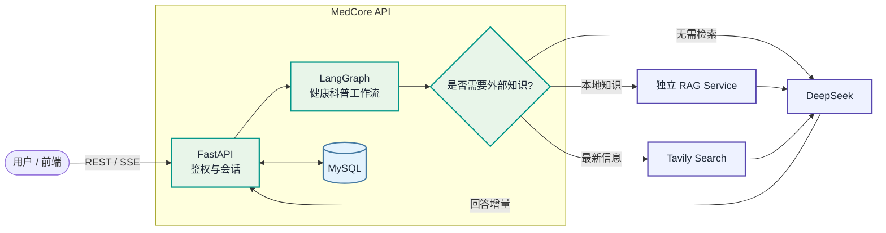
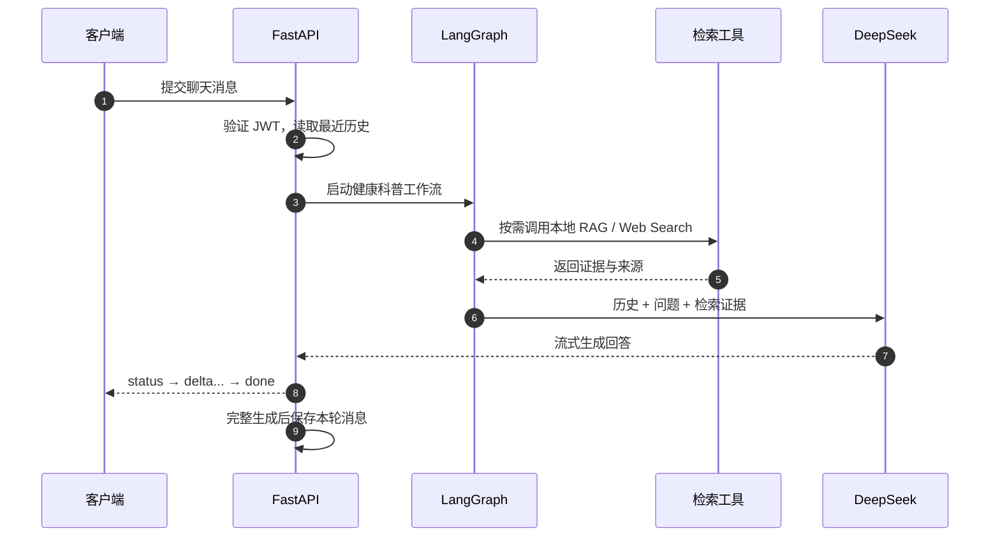
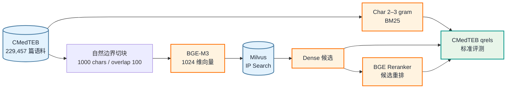

<div align="center">

# 🩺 MedCore

### 有依据、可追溯的健康科普后端

**多会话管理 · 按需医学检索 · 流式 AI 回答**

<p>
  
  
  
  
</p>

<p>
  
  
  
  
</p>

[快速开始](#-快速开始) · [系统架构](#-系统架构) · [能力边界](#-能力与边界) · [RAG 实验](#-rag-离线实验) · [接口](#-接口概览)

</div>

---

MedCore 面向普通用户提供中文健康科普服务。系统结合会话历史理解问题，按需查询本地医学知识库或联网搜索，再由 DeepSeek 生成带来源的回答。项目当前处于 MVP 阶段，目标是建立一条**可测试、可追踪、可持续迭代**的问答链路。

> [!IMPORTANT]
> MedCore 用于健康知识科普，不能替代医生诊断、处方或急救服务。遇到危急症状时，请立即联系当地急救机构或前往医疗机构。

## ✨ 核心能力

<table>
  <tr>
    <td align="center" width="25%">
      <strong>💬 多轮会话</strong><br>
      <sub>JWT 鉴权、会话隔离<br>历史消息持久化</sub>
    </td>
    <td align="center" width="25%">
      <strong>🔎 按需检索</strong><br>
      <sub>本地医学 RAG<br>Tavily 联网搜索</sub>
    </td>
    <td align="center" width="25%">
      <strong>⚡ 流式回答</strong><br>
      <sub>SSE 状态事件<br>回答增量实时返回</sub>
    </td>
    <td align="center" width="25%">
      <strong>📚 来源追踪</strong><br>
      <sub>仅展示实际引用来源<br>保留检索证据</sub>
    </td>
  </tr>
</table>

| 项目 | 当前实现 |
| :--- | :--- |
| 核心场景 | 健康科普、多轮问答、医学知识检索 |
| 后端技术 | Python 3.11+ · FastAPI · LangGraph · SQLAlchemy · MySQL |
| 模型与工具 | DeepSeek · BGE-M3 · BGE Reranker · Milvus · Tavily |
| 交互方式 | REST API + SSE 流式响应 |
| 工程范围 | 后端 API、工作流、数据库迁移、自动化测试、离线 RAG 实验 |

## 🚀 快速开始

### 1. 准备环境

需要预先安装 Python 3.11+、[uv](https://docs.astral.sh/uv/) 和 MySQL。在项目目录执行：

```bash
uv sync --frozen
cp .env.example .env
```

编辑 `.env`，至少填写 MySQL 连接信息、`JWT_SECRET_KEY` 和 `DEEPSEEK_API_KEY`。可以使用下面的命令生成 JWT 密钥：

```bash
python -c "import secrets; print(secrets.token_urlsafe(32))"
```

### 2. 初始化数据库

```bash
PYTHONPATH=src .venv/bin/alembic upgrade head
```

### 3. 启动 API

```bash
PYTHONPATH=src .venv/bin/uvicorn medcore.main:app \
  --host 127.0.0.1 \
  --port 8089 \
  --reload
```

服务启动后访问：

- Swagger UI：<http://127.0.0.1:8089/docs>
- OpenAPI JSON：<http://127.0.0.1:8089/openapi.json>

> [!NOTE]
> `/check_health` 当前只是占位接口，不代表数据库、模型和 RAG 服务均处于健康状态。后端默认仅监听本机，对外发布时应配置反向代理。

<details>
<summary><strong>查看环境变量说明</strong></summary>

| 配置项 | 用途 | 何时需要 |
| :--- | :--- | :--- |
| `MYSQL_HOST` / `MYSQL_PORT` | MySQL 地址和端口 | 启动后端前 |
| `MYSQL_USER` / `MYSQL_PASSWORD` / `MYSQL_DATABASE` | MySQL 凭据和数据库 | 启动后端前 |
| `JWT_SECRET_KEY` | 签发、验证访问令牌 | 注册、登录和鉴权 |
| `DEEPSEEK_API_KEY` / `DEEPSEEK_MODEL` | 工具选择与回答生成 | AI 问答 |
| `RAG_SERVICE_URL` | 在线 RAG 服务地址，默认 `http://127.0.0.1:8091` | 本地知识检索 |
| `RAG_SERVICE_TOKEN` | 在线 RAG 服务鉴权令牌 | 服务启用鉴权时 |
| `RAG_TOP_K` | 本地召回数量，允许 1–10 | 调整检索规模时 |
| `TAVILY_API_KEY` | Tavily 搜索凭据 | 联网搜索 |

不要将真实的 `.env`、数据库密码或 API Key 提交到 Git。

</details>

## 🏗️ 系统架构





### 组件边界

| 组件 | 角色 | 是否独立运行 |
| :--- | :--- | :---: |
| `src/medcore/` | API、会话服务、LangGraph 工作流和外部服务客户端 | 否，属于主后端 |
| `src/medcore/rag/` | 调用在线 RAG 的 HTTP 客户端 | 否，属于主后端 |
| `rag/` | CMedTEB 离线检索、重排和评测工程 | 是，独立环境 |
| `rag_service/` | 响应 `POST /retrieve` 的在线检索服务 | 是，独立进程 |
| Milvus / DeepSeek / Tavily | 向量库、模型和搜索服务 | 是，外部依赖 |

## 🧭 能力与边界

| 能力 | 状态 | 说明 |
| :--- | :---: | :--- |
| 用户鉴权与多会话持久化 | ✅ 已实现 | JWT、会话隔离、历史消息分页 |
| 本地 RAG / 联网搜索 | ✅ 已接入 | 模型按需选择，外部服务需单独配置 |
| SSE 流式回答 | ✅ 已实现 | 返回规划、检索、生成状态及回答增量 |
| 引用来源展示 | 🟡 初步实现 | 仅返回答案中实际出现编号的来源，尚未验证逐句支持关系 |
| 基于结果继续补检 | ⚪ 未实现 | 当前只有一轮工具选择，不是自主循环 Agent |
| 症状问诊与临床分诊 | ⛔ 不支持 | 不应将健康科普功能用于确定性诊断 |

### 当前默认参数

> 以下是代码默认值或限制，不是性能指标。

| 参数 | 当前值 | 说明 |
| :--- | :---: | :--- |
| 参与本轮问答的历史消息 | 最近 12 条 | 尚未接入上下文压缩 |
| 单轮检索工具调用 | 最多 2 次 | 超出限制会报错 |
| 本地 RAG 召回数量 | 默认 5 条 | `RAG_TOP_K` 可调整为 1–10 |
| Web Search 返回数量 | 最多 5 条 | 由工具封装控制 |
| JWT 有效期 | 30 分钟 | 过期后需要重新登录 |

## 🧪 RAG 离线实验

`rag/` 是基于 [CMedTEB](rag/src/data/CMedTEB/README.md) 的中文医学检索实验工程，用于构建、比较和评测检索方案。它**不是 HTTP 服务**，不会直接响应后端发出的 `POST /retrieve`。

### 实验流水线



### 数据规模

| 任务 | 训练集 | 测试集 / 评测数据 |
| :--- | ---: | ---: |
| Retrieval | 20,000 条共享训练数据 | 229,457 篇语料 · 734 条查询 · 329,578 条 qrels |
| Rerank | 20,000 条共享训练数据 | 1,128 条 |
| STS | 10,000 条 | 5,000 条 |

数据许可证为 **CC BY-NC-SA 4.0**。完整统计见 [`data_stats.json`](rag/src/data/CMedTEB/data_stats.json)。

### 现有实验结果

下面是 `outputs/` 中 734 条查询的一次本地全量运行结果：

| 方案 | Hit Rate@1 | MRR@10 | nDCG@10 | Recall@100 |
| :--- | ---: | ---: | ---: | ---: |
| BM25 字符 n-gram | 30.25% | 0.3964 | 0.2499 | 52.86% |
| BGE-M3 Dense | 59.54% | 0.6847 | 0.4694 | 70.92% |
| **Dense + BGE Reranker** | **63.76%** | **0.7242** | **0.5025** | — |

> [!TIP]
> Reranker 只重排 Dense 的前 15 个父文档，因此不会扩大候选集，也不会提高 `Hit Rate@15` 或 `Recall@15`；它主要改善正确文档的靠前排序。

这些结果会受模型版本、硬件、Collection、切块方式和候选参数影响，不代表线上服务 SLA。

<details>
<summary><strong>展开：准备 RAG 实验环境</strong></summary>

默认约定：

| 资源 | 默认值 |
| :--- | :--- |
| Dense 模型 | `rag/models/bge-m3` |
| Reranker 模型 | `rag/models/bge-reranker-v2-m3` |
| Milvus | `http://localhost:19530` |
| Collection | `cmedteb_retrieval_1000` |
| Dense 切块 | 阈值 1,000 字符，上限 1,000 字符，重叠 100 字符 |

模型文件和 Milvus 数据不随项目提供。`rag/` 当前没有可安装的包入口，使用 `--no-install-project` 创建独立环境：

```bash
cd rag
uv sync --frozen --no-install-project
```

先执行不加载模型、不连接 Milvus 的数据校验：

```bash
.venv/bin/python src/code/cmed/ingest.py --dry-run
```

</details>

<details>
<summary><strong>展开：Dense 入库、检索与评测</strong></summary>

```bash
# 切块、向量化并写入 Milvus
.venv/bin/python src/code/cmed/ingest.py

# 单条检索
.venv/bin/python src/code/cmed/Dense_Retrieval/search.py \
  --query "糖尿病患者应该如何控制饮食？" \
  --top-k 5

# 734 条查询的完整评测
.venv/bin/python src/code/cmed/Dense_Retrieval/evaluate.py \
  --details outputs/cmed_retrieval_details.jsonl
```

</details>

<details>
<summary><strong>展开：BM25 构建、检索与评测</strong></summary>

BM25 不依赖 Milvus 或模型，但需要先构建本地索引：

```bash
.venv/bin/python src/code/cmed/BM25/bm25_index.py

.venv/bin/python src/code/cmed/BM25/search.py \
  "糖尿病患者应该如何控制饮食？" \
  --top-k 5

.venv/bin/python src/code/cmed/BM25/evaluate.py
```

</details>

<details>
<summary><strong>展开：Reranker 检索与评测</strong></summary>

执行前需要准备两个模型和 Dense Collection：

```bash
.venv/bin/python src/code/cmed/rerank/search.py \
  --query "糖尿病患者应该如何控制饮食？" \
  --top-k 5

.venv/bin/python src/code/cmed/rerank/evaluate.py \
  --details outputs/cmed_rerank_details.jsonl
```

</details>

建议先给评测命令添加 `--limit` 进行小规模冒烟测试，确认环境和参数无误后再运行全量数据。

## 🔌 接口概览

除注册和登录外，聊天接口均需携带请求头：

```http
Authorization: Bearer <access_token>
```

| 方法 | 路径 | 鉴权 | 作用 |
| :---: | :--- | :---: | :--- |
| `POST` | `/auth/register` | 否 | 注册用户 |
| `POST` | `/auth/login` | 否 | 获取访问令牌 |
| `POST` | `/api/v1/chats` | 是 | 创建会话 |
| `GET` | `/api/v1/chats` | 是 | 列出会话 |
| `GET` | `/api/v1/chats/{id}/messages` | 是 | 分页读取历史消息 |
| `POST` | `/api/v1/chats/{id}/turns` | 是 | 非流式生成一轮对话 |
| `POST` | `/api/v1/chats/{id}/turns/stream` | 是 | SSE 流式生成一轮对话 |
| `DELETE` | `/api/v1/chats/{id}` | 是 | 删除会话及消息 |

流式接口请求体：

```json
{
  "content": "什么是病毒？"
}
```

成功时依次返回 `status`、多个 `delta` 和 `done` 事件；失败时返回 `error`，且不会保存未完成的回复。

## 🗂️ 项目结构

```text
medcore/
├── src/medcore/
│   ├── api/                     # HTTP 路由与鉴权依赖
│   ├── services/                # 会话业务流程
│   ├── repositories/            # 数据库读写
│   ├── database/                # SQLAlchemy 模型与连接
│   ├── workflows/education/     # LangGraph 状态、提示词与工具
│   ├── llm/                     # DeepSeek 调用封装
│   ├── rag/                     # 在线 RAG 服务 HTTP 客户端
│   └── capabilities/web_search/ # 联网搜索
├── migrations/                  # Alembic 数据库迁移
├── tests/                       # 后端自动化测试
└── rag/                         # CMedTEB 离线检索与评测实验
```

## ✅ 测试

### 后端测试

```bash
PYTHONPATH=src .venv/bin/python -m unittest discover -s tests -q
```

### RAG 离线测试

以下测试不需要 Milvus 或模型：

```bash
cd rag
.venv/bin/python -m unittest src/code/cmed/test_ingest.py
.venv/bin/python src/code/cmed/Dense_Retrieval/test_retrieval.py
```

现有测试覆盖鉴权、会话隔离、工具选择接口、流式保存、文档切块、父文档聚合和检索指标。**测试通过不等于医学回答质量已经得到验证。**

## 🗺️ 下一步

- [ ] 多轮指代和上下文压缩
- [ ] 检索相关性与引用真实性回归集
- [ ] 用药咨询和紧急症状安全评测
- [ ] 基于检索结果的多轮补检
- [ ] 完整健康检查与可观测性
- [ ] 在线 RAG 延迟和质量基准

---

<div align="center">
  <sub>MedCore · 让每一次健康科普回答都有据可查</sub>
</div>
