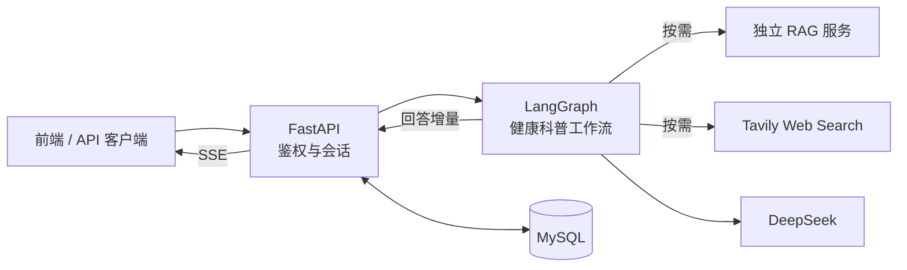

<div align="center">
  <h1>✦ MedCore</h1>
  <p><strong>有依据、可追溯的健康科普后端</strong></p>
  <p>多会话管理 · 按需医学检索 · 流式 AI 回答</p>
  <p>
    
    
    
    
  </p>
  <p><a href="#快速开始">快速开始</a> · <a href="#系统架构">系统架构</a> · <a href="#能力与边界">能力与边界</a> · <a href="#接口概览">接口概览</a></p>
</div>

---

MedCore 当前聚焦**面向普通用户的健康科普**。它结合会话历史理解问题，按需查询本地医学知识库或联网搜索，再用 DeepSeek 生成中文回答。项目仍处于 MVP 阶段，目标是建立可测试、可迭代的问答链路，而不是宣称具备临床诊断能力。

> [!IMPORTANT]
> 本仓库**只包含 FastAPI 后端**。Vue 前端、独立 RAG 检索服务、Milvus 和外部模型服务不在本仓库内。MedCore 不能替代医生诊断、处方或急救服务。

## 一眼看懂

| 项目 | 当前实现 |
| :--- | :--- |
| 核心场景 | 健康科普与多轮问答 |
| 技术栈 | Python 3.11+ · FastAPI · LangGraph · SQLAlchemy · MySQL |
| 模型与工具 | DeepSeek（OpenAI 兼容接口）· 本地 RAG · Tavily Web Search |
| 交互方式 | REST API + SSE 流式回答 |
| 仓库范围 | 后端 API、业务服务、工作流、数据库迁移与测试 |

## 快速开始

先准备 Python 3.11+、[uv](https://docs.astral.sh/uv/)、MySQL 和 DeepSeek API Key。在仓库根目录执行：

```bash
uv sync --frozen
cp .env.example .env
```

编辑 `.env`，至少设置 MySQL 连接信息、`JWT_SECRET_KEY` 和 `DEEPSEEK_API_KEY`。生成 JWT 密钥可以使用：

```bash
python -c "import secrets; print(secrets.token_urlsafe(32))"
```

随后执行数据库迁移并启动 API：

```bash
PYTHONPATH=src .venv/bin/alembic upgrade head
PYTHONPATH=src .venv/bin/uvicorn medcore.main:app --host 127.0.0.1 --port 8089 --reload
```

打开 [交互式 API 文档](http://127.0.0.1:8089/docs) 验证服务已启动。这里**不要**把 `/check_health` 当作完整健康检查：该接口目前只是占位实现。后端默认仅监听本机；若需外部访问，请通过前端代理或反向代理发布。

### 环境配置

| 配置项 | 用途 | 何时需要 |
| :--- | :--- | :--- |
| `MYSQL_HOST` / `MYSQL_PORT` / `MYSQL_USER` / `MYSQL_PASSWORD` / `MYSQL_DATABASE` | 连接业务数据库 | 启动后端前 |
| `JWT_SECRET_KEY` | 签发和验证登录令牌 | 注册、登录与鉴权 |
| `DEEPSEEK_API_KEY` / `DEEPSEEK_MODEL` | 生成回答与工具选择 | AI 问答 |
| `RAG_SERVICE_URL` / `RAG_TOP_K` | 访问独立 RAG 服务；默认地址为 `http://127.0.0.1:8091` | 使用本地检索时 |
| `TAVILY_API_KEY` | 联网搜索 | 使用 Web Search 时 |

本地 RAG 服务必须单独部署和启动；`RAG_SERVICE_TOKEN` 可按需配置。**不要把真实的 `.env` 或 API Key 提交到 Git。**

## 系统架构



前端发送问题后，后端验证 JWT、读取最近的会话历史，再运行工作流。工作流先决定是否调用检索工具，随后生成回答；流式接口通过 `status` 和 `delta` 事件返回进度与文本，**完整生成后**才保存本轮消息。详细设计见[健康科普架构文档](docs/health-education-architecture.md)。

## 能力与边界

| 能力 | 状态 | 说明 |
| :--- | :---: | :--- |
| 用户鉴权与多会话持久化 | 已实现 | JWT、会话隔离、历史消息分页 |
| 本地 RAG / 联网搜索工具 | 已接入 | 模型按需选择；外部服务需单独配置 |
| SSE 流式回答 | 已实现 | 规划、检索、生成状态与回答增量 |
| 引用来源展示 | 初步实现 | 只返回答案中出现编号的来源；尚未验证逐句支持关系 |
| 基于检索结果继续补检 | 未实现 | 当前只有一轮工具选择，不是自主循环 Agent |
| 症状问诊与临床分诊 | 未实现 | 不应将健康科普功能用于确定性诊断 |

### 当前默认参数

这些是代码中的默认值或限制，**不是性能指标**：

| 参数 | 当前值 | 说明 |
| :--- | :---: | :--- |
| 参与本轮问答的历史消息 | 最近 12 条 | 尚未接入上下文压缩 |
| 单轮检索工具调用 | 最多 2 次 | 超出限制会报错 |
| 本地 RAG 召回数量 | 默认 5 条 | 可通过 `RAG_TOP_K` 调整，范围 1–10 |
| Web Search 返回数量 | 最多 5 条 | 由工具封装设置 |
| JWT 有效期 | 30 分钟 | 过期后需重新登录 |

## 接口概览

登录接口是 `POST /auth/login`；其余聊天接口需在请求头携带 `Authorization: Bearer <access_token>`。

| 方法 | 路径 | 作用 |
| :--- | :--- | :--- |
| `POST` | `/auth/register` | 注册用户 |
| `POST` | `/auth/login` | 获取访问令牌 |
| `POST` / `GET` | `/api/v1/chats` | 创建 / 列出会话 |
| `GET` | `/api/v1/chats/{id}/messages` | 分页读取历史消息 |
| `POST` | `/api/v1/chats/{id}/turns` | 非流式生成一轮对话 |
| `POST` | `/api/v1/chats/{id}/turns/stream` | SSE 流式生成一轮对话 |
| `DELETE` | `/api/v1/chats/{id}` | 删除会话及消息 |

流式接口的请求体为 `{"content":"什么是病毒？"}`。成功时依次可收到 `status`、多个 `delta` 和 `done`；失败时返回 `error`，不保存半截回复。

## 目录与测试

```text
src/medcore/
├── api/                     HTTP 路由与鉴权依赖
├── services/                会话业务流程
├── repositories/            数据库读写
├── database/                SQLAlchemy 模型与连接
├── workflows/education/     状态、提示词、工具与 LangGraph 图
├── llm/                     DeepSeek 调用封装
├── rag/                     独立 RAG 服务的 HTTP 客户端
└── capabilities/web_search/ 联网搜索
migrations/                  Alembic 迁移
tests/                       后端自动化测试
```

```bash
PYTHONPATH=src .venv/bin/python -m unittest discover -s tests -q
```

现有测试覆盖鉴权、会话隔离、工具选择接口与流式保存；外部模型和检索调用使用模拟对象。**测试通过不等于医学回答质量已得到验证。** 下一步重点是多轮指代、检索相关性、引用真实性、用药咨询和紧急症状等回归评测。
