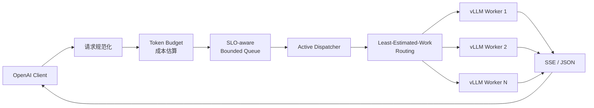

<div align="center">

# GoLLM Gateway

### 面向大模型推理服务的成本感知、SLO 感知调度网关

在客户端与 vLLM 之间建立可控的调度层，让短请求不再被长请求淹没，让过载发生在有界队列，而不是扩散到整个推理集群。

[](https://go.dev/)
[](#api-兼容性)
[](https://docs.vllm.ai/)

[快速开始](#快速开始) · [核心设计](#核心设计) · [配置](#连接真实-vllm) · [可观测性](#可观测性)

</div>

---

## 为什么需要 GoLLM

直接把所有并发请求交给 vLLM，虽然简单，却会失去对外部排队顺序的控制：短问答、长上下文和批处理请求可能进入同一个后端队列，Realtime 请求也可能等待数秒才收到首个 Token。

GoLLM Gateway 不只是 HTTP 反向代理。它在请求到达 vLLM 之前完成成本估算、优先调度、容量准入和 Worker 选择：

| 常规网关 | GoLLM Gateway V1 |
|---|---|
| 按请求数量限制并发 | 按估算 Token Cost 控制推理工作量 |
| FIFO 或静态优先级 | Workload Class + Deadline + Aging |
| Round Robin / Least Connections | Least-Estimated-Work 路由 |
| 请求直接堆进后端队列 | Gateway 主动派发，保持 vLLM 队列较浅 |
| 无限等待或被动超时 | 有界队列、明确 Deadline、快速 429 背压 |

## 请求链路



单 vLLM 部署仍然会使用成本准入、优先队列和主动派发；配置多个 vLLM 后，系统在此基础上增加推理工作量感知路由。

## 核心能力

### Token-Cost Admission

GoLLM 不把一个 20 Token 的短请求和一个 8K 上下文请求视为相同负载：

```text
RequestCost = EstimatedPromptTokens × PrefillWeight
            + ReservedOutputTokens  × DecodeWeight
```

Model Pool 和 Worker 都有独立的 Inflight Cost 上限。容量不足时，请求进入有界队列，而不是立即灌入 vLLM。

### SLO-aware Priority Queue

请求被归类为四种 Workload Class：

| Class | 典型请求 | 默认 SLO |
|---|---|---:|
| `realtime` | 流式短回答、在线判分 | 800ms |
| `interactive` | 普通对话、问答 | 3s |
| `long_context` | RAG、长文总结 | 10s |
| `batch` | 离线生成、批处理 | 无硬 Deadline |

调度综合考虑 Class、绝对 Deadline、入队时间和 Aging。短任务可以有限 Backfill，但 `max_bypass` 会阻止大任务永久饥饿。

### Least-Estimated-Work Routing

对于每个健康且容量足够的 Worker，Gateway 计算：

```text
ExpectedLoad = (WorkerInflightCost + RequestCost) / EWMAServiceRate
```

选择 Expected Load 最小的 Worker。吞吐速率只使用成功请求更新，取消、超时和上游 `5xx` 不会污染 EWMA。

### Streaming、Cancel 与 Backpressure

- SSE 数据增量转发，每次读取后立即 Flush；
- 客户端断开会沿 `context.Context` 取消上游请求；
- 首 Token 超时可在响应提交前返回结构化 `504`；
- 流式输出开始后的空闲超时会终止上游生成；
- 队列容量、队列 Cost 和最大等待时间都有上限；
- 过载请求返回 OpenAI 格式的 `429` 和 `Retry-After`。

## 快速开始

### 使用 Docker Compose

这会同时启动 Gateway 和可控的 Mock Backend，不需要 GPU：

```bash
git clone https://github.com/lshan02508-ai/GOLLM.git
cd GOLLM
docker compose -f deploy/docker-compose/compose.yaml up --build
```

检查服务：

```bash
curl http://127.0.0.1:8080/healthz
curl http://127.0.0.1:8080/readyz
curl http://127.0.0.1:8080/v1/models
```

发送 Chat Completions 请求：

```bash
curl http://127.0.0.1:8080/v1/chat/completions \
  -H 'Content-Type: application/json' \
  -d '{
    "model": "mock-model",
    "messages": [{"role": "user", "content": "Hello, GoLLM!"}]
  }'
```

流式请求：

```bash
curl -N http://127.0.0.1:8080/v1/chat/completions \
  -H 'Content-Type: application/json' \
  -d '{
    "model": "mock-model",
    "stream": true,
    "messages": [{"role": "user", "content": "Hello, GoLLM!"}]
  }'
```

### 使用 Go 本地运行

需要 Go 1.22 或更高版本。分别在两个终端运行：

```bash
make mock
```

```bash
make run
```

## 连接真实 vLLM

编辑 [`configs/gateway.yaml`](configs/gateway.yaml)，让模型名、Context Window 和 Worker Endpoint 与实际 vLLM 一致：

```yaml
token_budget:
  model_context_window_tokens:
    all-task: 8192

model_pools:
  all-task:
    model: all-task
    max_inflight_cost: 50000
    workers:
      - id: all-task-1
        endpoint: http://127.0.0.1:8889
        api_key: ""
        max_concurrency: 2
        max_inflight_cost: 50000
        initial_service_rate: 3000
```

启动 Gateway：

```bash
go run ./cmd/gateway -config configs/gateway.yaml
```

配置文件同时支持严格 JSON 和 YAML。未知字段、重复 YAML Key、多文档 YAML 或不支持的扩展名都会使启动失败，避免错误配置被静默忽略。

## OpenAI SDK

只需要把 SDK 的 `base_url` 指向 GoLLM：

```python
from openai import OpenAI

client = OpenAI(
    base_url="http://127.0.0.1:8080/v1",
    api_key="local-dev",
)

response = client.chat.completions.create(
    model="all-task",
    messages=[{"role": "user", "content": "用一句话介绍 GoLLM。"}],
)

print(response.choices[0].message.content)
```

## API 兼容性

| Method | Endpoint | 用途 |
|---|---|---|
| `POST` | `/v1/chat/completions` | JSON 与 SSE Chat Completions 代理 |
| `GET` | `/v1/models` | 返回当前可用模型 |
| `GET` | `/healthz` | Gateway 进程存活检查 |
| `GET` | `/readyz` | 至少一个 Worker 可用时返回 `200` |
| `GET` | `/metrics` | Prometheus 指标 |

Gateway 不重新构造请求 JSON，而是将经过大小限制的原始 Body 原样转发，因此 vLLM 的 OpenAI 扩展字段不会丢失。完整行为与错误码见 [`API.md`](API.md)。

## 可观测性

成功响应会携带调度信息，便于定位“为什么排队”和“被派发给谁”：

```text
X-GoLLM-Request-ID
X-GoLLM-Workload-Class
X-GoLLM-Task-Kind
X-GoLLM-Prompt-Tokens-Estimated
X-GoLLM-Reserved-Tokens
X-GoLLM-Request-Cost
X-GoLLM-Queue-Wait-Ms
X-GoLLM-Scheduler-Reason
X-GoLLM-Worker-ID
X-GoLLM-Worker-Expected-Load
```

`/metrics` 提供 Prometheus 文本指标，包括：

- 请求数、错误数和当前 Inflight；
- Queue Depth、Queued Cost 和 Inflight Cost；
- 按 Model / Class 统计的入队、派发和拒绝；
- Worker 健康状态、Active Requests 和 Service Rate；
- Queue Wait、Request Duration 和 TTFT。

## 过载行为

Gateway 不会无限接受无法按时执行的请求：

| 场景 | HTTP | Error Code |
|---|---:|---|
| 单请求成本超过容量 | `429` | `request_cost_exceeded` |
| 有界队列已满 | `429` | `queue_full` |
| 最大排队时间耗尽 | `429` | `queue_timeout` |
| 调度 Deadline 到期 | `429` | `deadline_exceeded` |
| 没有健康 Worker | `503` | `no_available_worker` |
| 首 Token 超时 | `504` | `first_token_timeout` |

所有 Gateway 错误都使用 OpenAI 风格的 Error Envelope；后端返回的状态码和 Body 则保持原样。

## 项目结构

```text
gollm-gateway/
├── cmd/
│   ├── gateway/                  # Gateway 进程入口
│   └── mock-backend/             # 本地可控推理后端
├── internal/
│   ├── adapters/config/          # JSON / YAML 配置加载
│   ├── app/                      # 依赖组装与生命周期
│   ├── core/
│   │   ├── cost/                 # Token Budget 与成本估算
│   │   ├── router/               # Least-Estimated-Work 路由
│   │   └── scheduler/            # 准入、队列与主动派发
│   ├── proxy/                    # OpenAI 代理与 SSE 生命周期
│   ├── registry/                 # Worker Registry 与健康检查
│   └── telemetry/                # Prometheus 指标
├── pkg/headers/                  # 公共 X-GoLLM Header 定义
├── configs/                      # 示例配置
└── deploy/docker-compose/        # 本地容器化环境
```

## 开发与验证

```bash
make fmt     # 格式化 Go 代码
make test    # 运行全部测试
make race    # 运行 Race Detector
make build   # 构建 Gateway 与 Mock Backend
```

进一步阅读：

- [`ARCHITECTURE.md`](ARCHITECTURE.md)：请求生命周期、容量模型和超时边界；
- [`API.md`](API.md)：接口兼容性、响应 Header 和错误映射；
- [`CONTRIBUTING.md`](CONTRIBUTING.md)：开发与贡献流程；
- [`SECURITY.md`](SECURITY.md)：安全问题报告方式。


---

<div align="center">

如果这个项目对你有帮助，欢迎提交 Issue、参与讨论或贡献代码。

</div>
